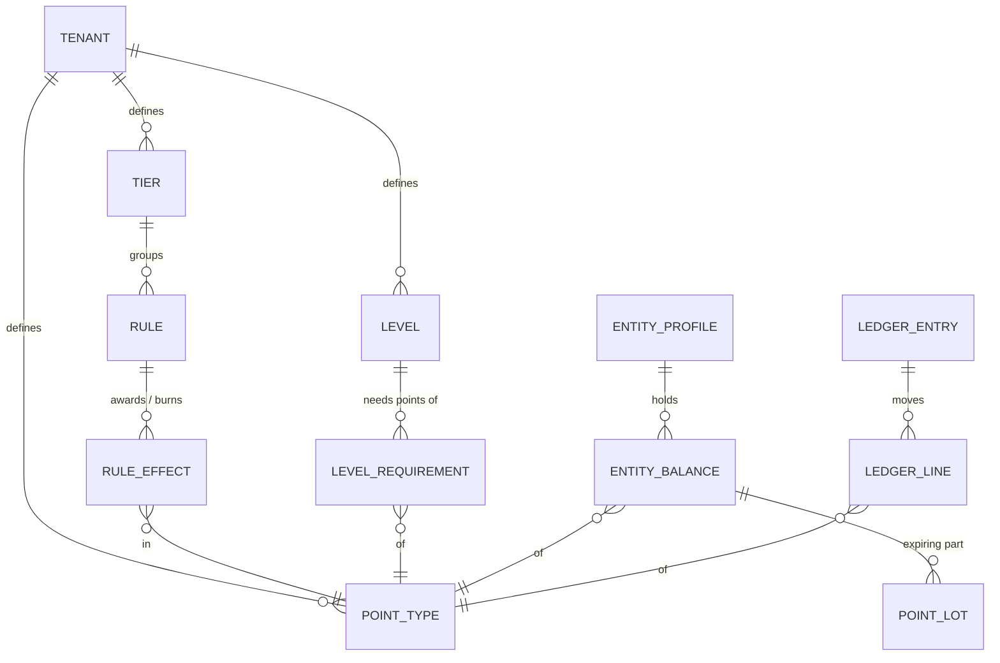
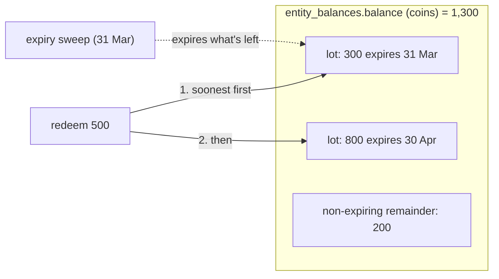

# Design Plan: Multiple Point Types, Expiry, Variable Amounts and Richer Levels

Status: implemented (migration `0003_point_types.sql`).

This plan extends the engine so that one tenant can run programs like Daraz, Shopee and Lazada:
spendable coins that expire, a separate non-spendable counter (XP or engagement), earning
proportional to order value, redemptions of any amount, check-in streaks, caps on how much can
be earned or redeemed per day/week/month, and levels that combine spend, order count and points.

## 1. Goals and non-goals

**Goals**

| # | Feature | Needed by |
|---|---|---|
| F1 | Variable amounts: earn per unit of spend (with a cap), redeem a caller-supplied amount | Daraz, Shopee, Lazada |
| F2 | Several point types per tenant (e.g. `coins` + `xp`), each with its own balance | Lazada, the "XP + coins" design |
| F3 | Expiry of earned points: N days after earning, or end of the Nth calendar month | Daraz, Shopee, Lazada |
| F4 | Per-period caps on earning and redeeming (day / week / month, in the tenant's time zone) | Daraz, Shopee |
| F5 | Daily check-in streaks with escalating rewards that reset after a missed day | Daraz, Lazada |
| F6 | Levels that require spend **and/or** order count **and/or** points earned | Shopee (orders + spend), Lazada (spend + engagement), Daraz (gems collected) |
| F7 | A fixed calendar-period basis for levels (e.g. Jan-Jun / Jul-Dec) | Shopee |
| F8 | A minimum tenure for a level before it can be lost | Daraz Club (at least 6 months) |

**Non-goals** (stay in the tenant's checkout code): per-order discount caps (e.g. "at most 5% of
the order"), excluded product categories, coin-to-currency conversion rates.

**Compatibility goal:** a tenant that never touches the new features keeps working exactly as
before. `point_delta` on rules, `points` on adjustments, `balance` on profiles and
`point_delta`/`balance_before`/`balance_after` on ledger entries all keep their meaning, applied
to the tenant's *primary* point type.

## 2. Concepts



### 2.1 Point types (F2)

A **point type** is a currency the tenant defines: `coins`, `gems`, `xp`, `lazcoins`, ...

| Field | Meaning |
|---|---|
| `slug`, `name`, `description` | Identity and display |
| `is_primary` | Exactly one per tenant. Legacy fields (`point_delta`, `balance`, ...) refer to it |
| `spendable` | `false` means rules can only *award* it (XP). Adjustments can still correct it, and it can never go below zero |
| `expiry_mode`, `expiry_value` | Default expiry for earned points: `never`, `days` (N days after earning) or `end_of_month` (end of the Nth calendar month, counting the earning month as month 1) |
| `limits` | Per-entity caps: `[{"direction": "credit"\|"debit", "period": "day"\|"week"\|"month", "max": N}]` |

Every tenant gets a primary type `points` (spendable, never expires) when it is created, and the
migration creates one for every existing tenant from the old single balance. The primary type can
be renamed and reconfigured; another type can be made primary.

A point type can be deleted only while nothing references it (no balances, rules, levels or
ledger lines). After that, history depends on it.

### 2.2 Rule effects (F1, F5)

A rule no longer has one `point_delta`. It has a list of **effects**, at most one per point type:

| `kind` | Amount | Typical use |
|---|---|---|
| `fixed` | `amount` | Daily login +10 XP; redeem a fixed voucher for 250 coins |
| `per_spend` | `floor(max(spend, 0) * rate_points / rate_per)` | 1 coin per PKR: `rate_points: 1, rate_per: 100` when spend is in paisa |
| `input` | The `amount` field of the execution request | Redeem any number of coins at checkout |
| `streak` | `steps[day_in_streak - 1]` | 7-day check-in: `steps: [5,5,10,10,15,15,30]` |

Each effect also has:

- `direction`: `credit` (default) or `debit`. Amounts are always positive; the direction gives
  the sign. Debits on non-spendable types are rejected when the rule is saved.
- `min` / `max`: per-transaction bounds. For `input`, a value outside them is rejected
  (`amount_out_of_range`). For computed kinds, `max` clamps (Daraz: at most 2,000 coins per order).
- `expiry_mode` / `expiry_value` (credits only): overrides the point type's default expiry for
  what this rule awards. This answers "some rules give points that roll down, others lifelong":
  a promo rule can award coins that expire in 30 days while purchases award coins that never
  expire, or the reverse with `expiry_mode: "never"`.

A rule also has `order_delta` (default 0): `1` for a completed order, `-1` for a cancellation or
refund. Order counts feed level requirements (F6).

`point_delta` is still accepted when creating or updating a rule as shorthand for a single
`fixed` effect on the primary point type (negative = debit).

**Streaks (F5).** A rule with a `streak` effect is claimable once per calendar day in the tenant's
time zone. Claiming on the day after the last claim extends the streak, claiming later restarts it
at day 1, and after the last step it starts again at day 1. A second claim on the same day gets
`429 streak_already_claimed` with `Retry-After` set to the next local midnight. Streak state lives
in `entity_streaks`, keyed by rule **slug**, so a streak carries over when the entity moves to
another tier with a rule of the same slug (e.g. after a level upgrade).

### 2.3 Balances, lots and expiry (F3)



- `entity_balances` holds one row per (entity, point type): `balance`, `lifetime_earned`,
  `qualifying_earned`. `CHECK (balance >= 0)` keeps every type non-negative.
- A credit whose effective expiry isn't `never` also adds to a **lot**: a bucket of points with the
  same `expires_at`. Credits with the same expiry instant merge into one lot, so a user has at most
  one lot per day of activity (`days`) or per month (`end_of_month`).
- The part of a balance not covered by lots never expires. Invariant:
  `0 <= sum(lots.remaining) <= balance`.
- A debit consumes lots in `expires_at` order, soonest first, and only touches the non-expiring
  remainder once every lot is used up. Users always spend the points that would expire first.
- **Expiry** writes an append-only ledger entry with `entry_type: "expiry"` that debits the
  expired remainder. It happens in two places:
  1. inside every transaction for that entity, before anything else, so a user can never spend
     coins that have already expired;
  2. in a background sweep (`EXPIRY_SWEEP_INTERVAL`, default 15m, advisory-locked to one instance)
     so balances read through the API catch up even for idle users.
- Lots are working state, not history. They are deleted once empty; the ledger is the audit trail.
- Changing a point type's expiry policy affects only future credits. Lots keep the expiry they
  were earned with.

`expires_at` is computed in the tenant's time zone (`tenants.timezone`, IANA name, default `UTC`):

Both modes expire at a local midnight, so everything earned on the same day (`days`) or in the
same month (`end_of_month`) merges into one lot:

| Mode | Earned 15 Jan 14:00 | Expires at |
|---|---|---|
| `days`, 90 | | 16 Apr 00:00 local (valid through 15 Apr) |
| `end_of_month`, 3 | | 1 Apr 00:00 local (valid through 31 Mar) |

### 2.4 Period limits (F4)

Point type `limits` cap what one entity can earn or redeem **through rules** per calendar day
(00:00 local), ISO week (Monday 00:00 local) or calendar month. Adjustments and expiry don't count
toward them and aren't limited by them.

- A **credit** over the cap is *clamped*: the user gets what is left of the allowance, possibly 0.
  The ledger entry is still written so spend and orders are recorded.
- A **debit** over the cap is *rejected* with `422 point_limit_exceeded`, because a partial
  redemption would take coins without giving the full discount.

The totals come from the ledger (`ledger_lines`, indexed by entity, type and time) inside the
transaction. Because the profile row is locked, concurrent requests can't both pass a cap.

### 2.5 Levels (F6, F7, F8)

Levels get an explicit `rank` (unique per tenant, higher is better) and three kinds of
requirement, **all** of which must be met:

| Field | Compared with |
|---|---|
| `min_spend` | qualifying spend |
| `min_orders` | qualifying orders (sum of `order_delta`, plus adjustment `orders`) |
| `min_points: {"xp": 500}` | qualifying points earned per point type |

**Points earned** counts rule credits and adjustments (either sign), but not redemptions or
expiry. So redeeming coins never costs a level, and Daraz's "gems collected" threshold doesn't
drop when gems are spent.

The level policy gains a basis and a tenure field:

| `basis` | Qualifying window | Example |
|---|---|---|
| `lifetime` | Everything ever | "Once Gold, always Gold" |
| `rolling` + `window_days` | The last N days | Airline-style yearly status, Lazada's monthly recalculation |
| `calendar` + `period_months` (1, 2, 3, 4, 6 or 12) | The current calendar period, aligned to 1 January in the tenant's time zone | Shopee: Jan-Jun and Jul-Dec |

Under `calendar`, the target level is the better of the level met by the **current** period and
the level met by the **previous** period. Reaching Gold in November keeps Gold through the next
period. At the next boundary, if neither period supports it, the downgrade rules apply. This is
exactly Shopee's "points earned 1 Jan-30 Jun qualify you for 1 Jul-31 Dec".

`min_tenure_days` (F8): a level can't be lost (by grace expiry) until the entity has held it for
this many days. Deactivated or deleted levels still move entities immediately.

Evaluation still runs after every ledger write, on the hourly sweep and on manual re-evaluation.
The sweep now also covers tenants on the `calendar` basis.

## 3. Transaction pipeline

```mermaid
sequenceDiagram
    participant B as Tenant backend
    participant A as API
    participant R as Redis
    participant P as Postgres (one transaction)
    B->>A: POST /engine/execute {user_id, rule, spend, amount, idempotency_key}
    A->>R: idempotency lock, then cooldown + rate-limit reservation
    A->>P: lock profile row
    P->>P: expire due lots for this entity (entry_type = expiry)
    P->>P: streak step (if the rule has a streak effect)
    P->>P: compute each effect: fixed / per_spend / input / streak, then min/max
    P->>P: period caps: clamp credits, reject over-cap debits
    P->>P: update balances, add/merge lots for credits, consume lots for debits
    P->>P: insert ledger entry + one ledger line per point type
    P->>P: re-evaluate level (spend, orders, points; lifetime/rolling/calendar)
    P-->>A: entry, lines, level change, streak
    A-->>B: 201 {..., lines: [...], level_change, streak}
```

## 4. Schema changes (`0003_point_types.sql`)

| Change | Notes |
|---|---|
| `tenants.timezone` | `text NOT NULL DEFAULT 'UTC'` |
| `tenants.level_basis` | adds `calendar`; new `level_period_months`, `level_min_tenure_days` |
| `point_types` | new; partial unique index enforces one primary per tenant |
| `rule_effects` | new; FK to rule (cascade) and point type (restrict) |
| `rules.order_delta` | new; `rules.point_delta` is dropped after being migrated into effects |
| `entity_balances` | new; backfilled from `entity_profiles.balance`, which is dropped |
| `entity_profiles.lifetime_orders`, `qualifying_orders` | new |
| `point_lots` | new; unique on (tenant, entity, type, expires_at) so lots merge |
| `entity_streaks` | new |
| `ledger_entries` | `entry_type` adds `expiry`; new `orders`, `input_amount`. `point_delta` / `balance_*` now summarise the primary type |
| `ledger_lines` | new, append-only; backfilled from existing entries |
| `levels.rank`, `levels.min_orders` | new; ranks backfilled in `min_spend` order; the unique `min_spend` constraint is replaced by unique `rank` |
| `level_requirements` | new; per point type minimums |
| `level_changes` | new `qualifying_orders`, `qualifying_points` snapshot |

## 5. API changes

| Area | Change |
|---|---|
| Onboarding | `POST /platform/tenants` accepts `timezone` |
| Settings | `GET/PATCH /admin/settings` (`timezone`) |
| Point types | `GET/POST /admin/point-types`, `GET/PATCH/DELETE /admin/point-types/{id}` |
| Rules | `effects`, `order_delta`; `point_delta` stays as shorthand |
| Levels | `rank` (required), `min_orders`, `min_points` |
| Level policy | `basis: calendar`, `period_months`, `min_tenure_days` |
| Execute | `amount` for `input` effects; response adds `lines`, `orders`, `amount`, `streak` |
| Adjustments | `point_type` (default primary), `orders` |
| Profiles | `balances` per point type, `lifetime_orders`, `qualifying_orders` |
| Expiry | `GET /data/profiles/{id}/expirations` lists upcoming expiries |
| Logs | `point_type` filter; `entry_type=expiry`; entries carry `lines` |

New error codes: `amount_required`, `amount_not_accepted`, `amount_out_of_range` (422),
`point_limit_exceeded` (422), `streak_already_claimed` (429), `point_type_not_found` (404),
`point_type_not_spendable` (422), `point_type_in_use` (409), `level_rank_taken` (409).

## 6. Decisions and trade-offs

| Decision | Why |
|---|---|
| Keep a primary point type and the legacy fields | Existing integrations, tests, seed files and the console keep working unchanged |
| Lots only for expiring credits | XP and never-expiring coins cost nothing extra; expiring programs pay one row per expiry bucket |
| Soonest-expiring points are spent first | It's what users expect; any other order destroys value |
| Credits over a cap are clamped, debits are rejected | Users never lose coins without getting the full redemption |
| Expire inside transactions *and* in a sweep | Writes are always exact; reads converge within the sweep interval |
| `per_spend` ignores negative spend | Matches all three platforms (earned coins aren't clawed back on refund). Clawbacks are explicit adjustments or a dedicated debit rule |
| Calendar periods aligned to 1 January | Matches Shopee; `period_months` must divide 12 so periods never straddle years unevenly |
| Explicit level `rank` | With several requirement types there's no natural ordering by spend |
| Time zone per tenant, computed in Go with embedded tzdata | Day/week/month boundaries, month-end expiry and streak days must follow the tenant's local calendar |

## 7. Testing

- Unit tests: period and expiry date math across time zones and DST, effect computation, validation.
- Integration tests (real Postgres + Redis): multiple point types per rule, per-spend earning with
  caps, input redemptions with bounds, non-spendable enforcement, lots consumed soonest-first,
  expiry in the sweep and inside transactions, day/week caps (clamp vs reject), streak
  progression/reset/same-day rejection, multi-criteria levels, calendar basis carry-over,
  minimum tenure, migration of legacy data, and all existing tests unchanged in behaviour.

## 8. Rollout

1. Deploy; `AUTO_MIGRATE` applies `0003` under the advisory lock. Old instances must be stopped
   first, because the migration drops `entity_profiles.balance` and `rules.point_delta`.
2. Existing tenants find a primary `points` type holding their old balances, and every rule has
   one effect equivalent to its old `point_delta`.
3. Tenants opt in to new point types, effects and level requirements through the admin API, the
   console or a seed file.
