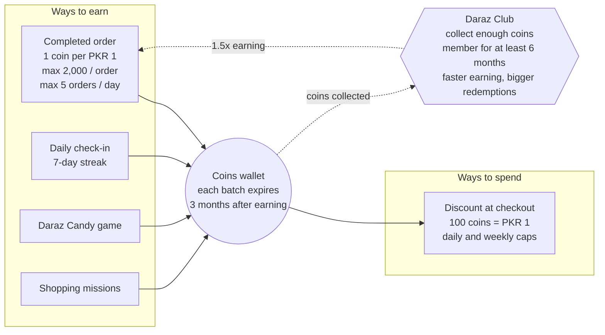
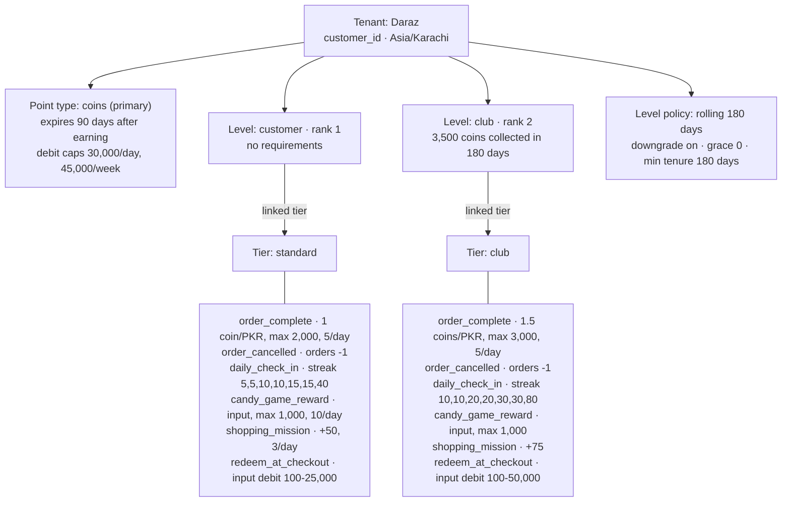
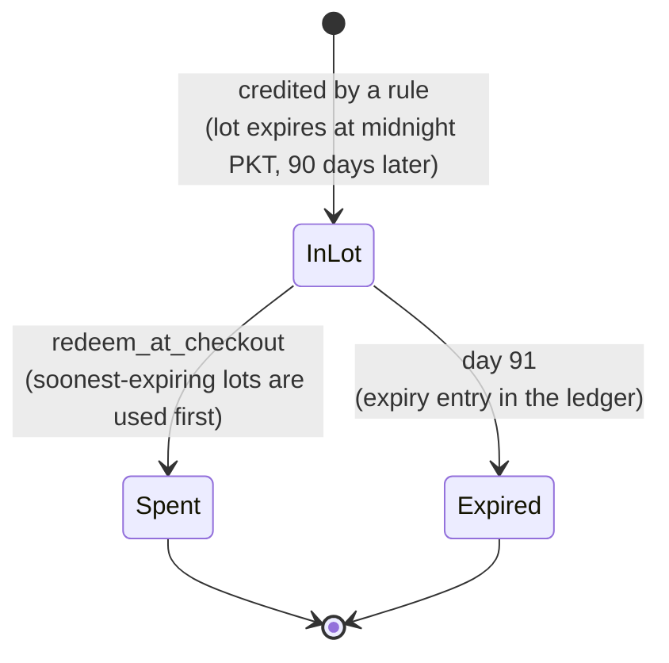
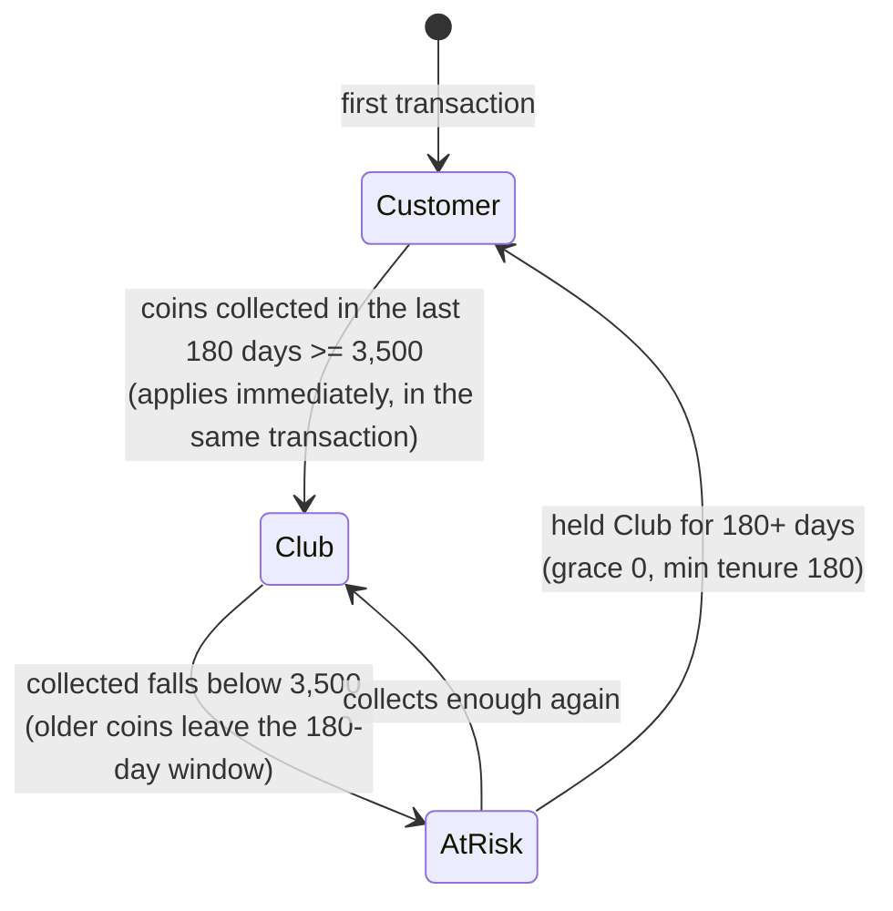
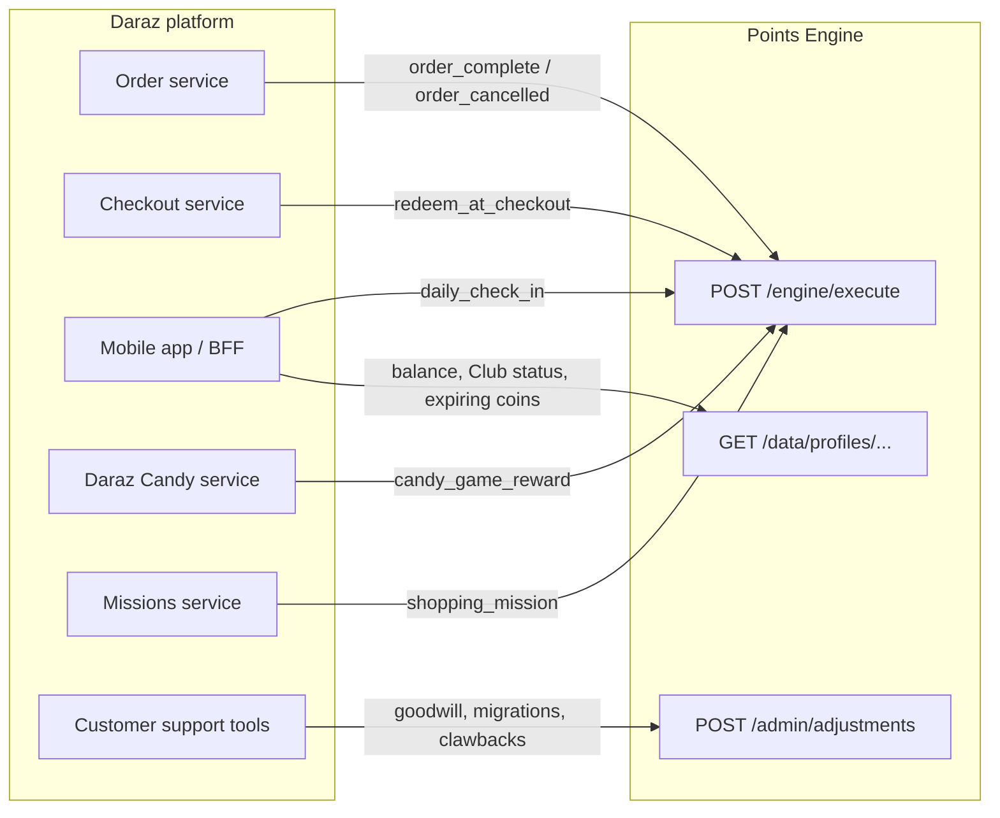
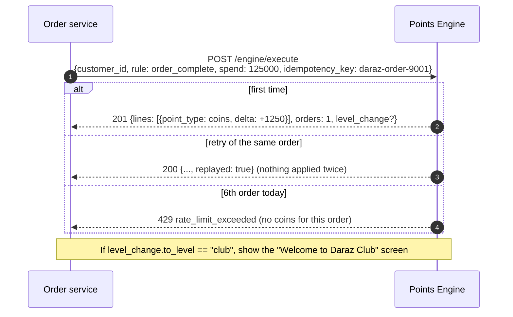
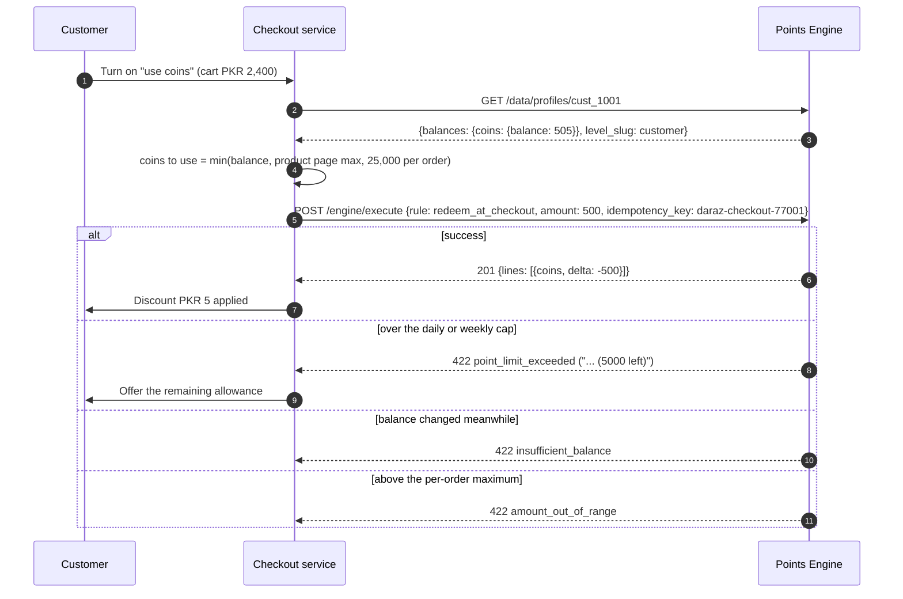
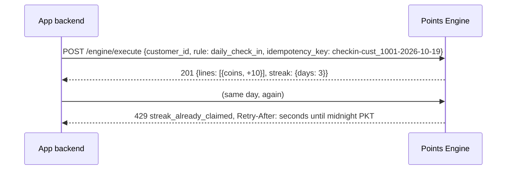

# Daraz on the Points Engine

How Daraz's loyalty program works, how it is configured as a tenant in this engine
(`seeds/daraz.json`), and how Daraz's backend talks to the engine.

> **Sources and assumptions.** The program below follows Daraz Pakistan's published Coins terms
> and Daraz Nepal's Gems / Daraz Club announcements (2022-2023). Daraz doesn't publish every
> number (check-in rewards, exact caps per market), so values marked *illustrative* are
> reasonable stand-ins, not Daraz's real figures. Everything is configuration: change the seed
> file and re-run it.

## 1. How Daraz's points system works

Daraz runs **one spendable currency**, called **Coins** in Pakistan and Bangladesh and **Gems**
in Nepal. On top of it sits **Daraz Club**, a membership you join by collecting enough coins.



| Aspect | Daraz's rule |
|---|---|
| Earning on orders | 1 coin per PKR 1 after a successful order, up to 2,000 coins per order and 5 earning orders a day |
| Other earning | Daily check-in (7-day streak; missing a day resets it), Daraz Candy game, shopping missions. These don't count toward the order caps |
| Value | 100 coins = PKR 1 off at checkout |
| Expiry | Earned coins expire 3 months after they are earned |
| Redemption caps | Daily and weekly limits (Nepal published 30,000/day and 45,000/week for Gems); a per-order maximum shown on the product page |
| Refunds | Coins used on a cancelled or refunded order are forfeited. Coins *earned* on a refunded order are kept |
| Daraz Club | Joined automatically by collecting enough coins (2,500-3,500 Gems in Nepal). Membership lasts at least 6 months. Members earn faster and can redeem more per order |

## 2. How it is configured in the engine

### 2.1 Concept mapping

| Daraz concept | Engine concept | Configuration |
|---|---|---|
| A customer | Entity, keyed by the architecture key `customer_id` | `tenant.architecture_key` |
| Pakistan's calendar day | Tenant time zone `Asia/Karachi` | Day/week caps and check-in days roll over at midnight PKT |
| Coins | Primary point type `coins` | Spendable, `expiry_mode: days`, `expiry_value: 90` |
| Daily and weekly redemption caps | Point type `limits` | `debit / day / 30,000` and `debit / week / 45,000` |
| 1 coin per PKR, max 2,000 per order | Rule effect `per_spend` | `rate_points: 1, rate_per: 100` (spend is sent in paisa), `max: 2000` |
| 5 earning orders per day | Rule rate limit | `rate_limit_max: 5`, `rate_limit_window_seconds: 86400` |
| Check-in streak | Rule effect `streak` | `steps: [5, 5, 10, 10, 15, 15, 40]` *(illustrative)* |
| Candy game prize | Rule effect `input` (credit) | The game backend sends the prize as `amount` (max 1,000) |
| Redeem at checkout | Rule effect `input` (debit) | `min: 100`, `max: 25,000` per order (50,000 for Club) |
| Earned coins kept on refund | `order_cancelled` has no coin effect | It only reverses the order count; the backend sends negative spend |
| Daraz Club | Level `club` (rank 2), linked to tier `club` | `min_points: {"coins": 3500}`: coins **collected**, which redemptions don't reduce |
| "Membership lasts at least 6 months" | Level policy `min_tenure_days: 180` | With `basis: rolling, window_days: 180, downgrade: true` |
| Club perks (faster earning, bigger redemptions) | Tier `club` | The same rule slugs with richer effects |

### 2.2 What gets created



Both tiers use **the same rule slugs**, so Daraz's backend always calls `order_complete`,
`daily_check_in` and so on **without naming a tier**. The engine picks the tier linked to the
customer's level: Club members automatically get the Club rates. Because check-in streaks are
keyed by rule slug, a customer who joins the Club mid-streak keeps it.

### 2.3 How a coin moves through the system



Every movement is an append-only ledger entry: `rule` for earning and redemption, `adjustment`
for corrections, and `expiry` for coins that ran out. All coins earned on the same day share one
lot and one expiry date. The app can show them with `GET /data/profiles/{id}/expirations`.

### 2.4 How Daraz Club membership is decided



"Collected" counts rule credits and adjustments; redemptions and expiry don't reduce it, so
**spending coins never costs a customer their Club membership**. The hourly level sweep applies
the time-based changes (coins ageing out, tenure ending) even for customers who do nothing.

## 3. How Daraz's backend talks to the engine

### 3.1 Integration architecture



All calls carry `Authorization: Bearer <Daraz API key>`. Calls are server to server; the mobile
app reaches the engine only through Daraz's own backend (BFF), never with the API key.

### 3.2 Order completed → coins



```sh
curl -X POST $ENGINE/engine/execute -H "Authorization: Bearer $DARAZ_KEY" -d '{
  "customer_id": "cust_2001", "rule": "order_complete",
  "spend": 125000, "idempotency_key": "daraz-order-9001"
}'
```

```json
{
  "entry_type": "rule", "tier": "standard", "rule": "order_complete",
  "point_delta": 1250, "balance_before": 0, "balance_after": 1250,
  "lines": [{ "point_type": "coins", "delta": 1250, "balance_before": 0, "balance_after": 1250 }],
  "spend": 125000, "orders": 1, "amount": null,
  "idempotency_key": "daraz-order-9001",
  "level_change": { "direction": "up", "from_level": null, "to_level": "customer",
                    "qualifying_spend": 125000, "qualifying_orders": 1, "qualifying_points": { "coins": 1250 } },
  "replayed": false
}
```

- **Spend is in paisa** (PKR × 100). The engine works out `floor(125000 × 1 / 100) = 1250` coins
  and caps the result at 2,000 (3,000 for Club).
- Use the **order ID as the idempotency key**, so network retries never double-credit.
- Don't send `tier`: the engine picks `standard` or `club` from the customer's level.
- Optionally, when an order hits `429 rate_limit_exceeded`, record it anyway with a rule that has
  no coin effect (for example an `order_record` rule with `order_delta: 1`) so spend and order
  counts stay complete.

### 3.3 Redeeming coins at checkout



- Burn the coins **when the order is placed**, with the checkout or payment ID as the
  idempotency key. Under Daraz's terms, coins used on an order that is later cancelled are
  forfeited, so there is nothing to undo. To be more generous, credit them back with an
  adjustment.
- The engine spends the coins that would expire soonest first.
- Product-level rules (maximum discount shown on the product page, excluded categories such as
  mobile top-ups) stay in checkout. The engine enforces the per-order maximum and the
  daily/weekly caps.

### 3.4 Daily check-in



Day 1 pays 5, day 2 pays 5, day 3 pays 10, ..., day 7 pays 40, then the cycle restarts. Missing a
day starts again at day 1. A good idempotency key is `checkin-<customer>-<local date>`.

### 3.5 Games, missions and refunds

| Event | Call |
|---|---|
| Candy prize decided by the game server | `{"rule": "candy_game_reward", "amount": 200, "idempotency_key": "candy-<round id>"}` |
| Mission completed | `{"rule": "shopping_mission", "idempotency_key": "mission-<mission id>-<customer>"}` |
| Order cancelled or refunded | `{"rule": "order_cancelled", "spend": -125000, "idempotency_key": "daraz-order-9001-cancel"}`: reverses spend and order count; earned coins stay |
| Support goodwill or migration | `POST /admin/adjustments {"entity_id": "cust_1003", "points": 60000, "reason": "..."}` |
| Clawback for fraud | `POST /admin/adjustments {"entity_id": "...", "points": -500, "reason": "fraud review #123"}` |

### 3.6 Showing the wallet in the app

```sh
curl $ENGINE/data/profiles/cust_1002 -H "Authorization: Bearer $DARAZ_KEY"
curl $ENGINE/data/profiles/cust_1002/expirations -H "Authorization: Bearer $DARAZ_KEY"
```

```json
{
  "entity_id": "cust_1002", "balance": 5300,
  "balances": { "coins": { "balance": 5300, "lifetime_earned": 5300, "qualifying_earned": 5300 } },
  "level_slug": "club", "tier_slug": "club",
  "lifetime_spend": 730000, "lifetime_orders": 3, "below_level_since": null
}
```

```json
{ "data": [ { "point_type": "coins", "amount": 5300, "expires_at": "2027-01-17T19:00:00Z" } ] }
```

`expires_at` is midnight at the start of 18 January in Karachi; all three orders were earned on
the same day, so they share one lot. The app can show "5,300 coins · Daraz Club" and "5,300 coins
expire after 17 Jan". A non-null `below_level_since` means the customer is at risk of losing Club.
(Timestamps are rendered in the API server's time zone; the instant is the same.)

### 3.7 Error handling

| Response | Meaning | What Daraz's backend should do |
|---|---|---|
| `200` + `replayed: true` | Retry of a request that already succeeded | Treat it as success |
| `409 idempotency_in_progress` | Same key is being processed right now | Retry after a moment |
| `422 insufficient_balance` | Not enough coins | Refresh the balance and ask the customer again |
| `422 point_limit_exceeded` | Daily or weekly redemption cap reached | Show the remaining allowance from the message |
| `422 amount_out_of_range` | Below 100 or above the per-order maximum | Clamp the amount in checkout |
| `429 rate_limit_exceeded` | 6th earning order today | No coins for this order (optionally record it, see 3.2) |
| `429 streak_already_claimed` | Already checked in today | Show "come back tomorrow" (`Retry-After` = seconds to midnight PKT) |
| `503 limiter_unavailable` | Redis is down, so limits can't be enforced | Retry with backoff using the same idempotency key |

## 4. Seeded demo data

`seeds/daraz.json` also runs these demo transactions (all idempotent):

| Customer | What happened | Resulting state |
|---|---|---|
| `cust_1001` | Check-in, PKR 1,250 order, Candy prize 200, mission, redeemed 1,000, then cancelled the order | 505 coins; 0 orders; the coins from the cancelled order were kept |
| `cust_1002` | Orders of PKR 4,500 (capped at 2,000), 1,800 (reaches 3,800 collected → **Club**), 1,000 at the Club rate (+1,500) | 5,300 coins; **Daraz Club** |
| `cust_1003` | 60,000 coins migrated in (counts as collected → Club), redeemed 25,000; a further 10,000 is refused by the daily cap; 60,000 in one order is refused by the Club per-order maximum | 35,000 coins; Club |
| `cust_1004` | Five PKR 200 orders earn 200 coins each; the sixth is rate-limited | 1,000 coins |

## 5. Applying the configuration

```sh
# Creates the "Daraz" tenant on first run and stores its API key in seeds/tenant_keys.local.json
go run ./cmd/seed -platform-token "$PLATFORM_ADMIN_TOKEN" \
  -keys-file seeds/tenant_keys.local.json -file seeds/daraz.json
```

Re-running updates the configuration in place (matched by slug) and replays the demo steps.
To change a number, such as the Club threshold or a redemption cap, edit the seed file and
run it again, or use the admin console at `/ui/`.
