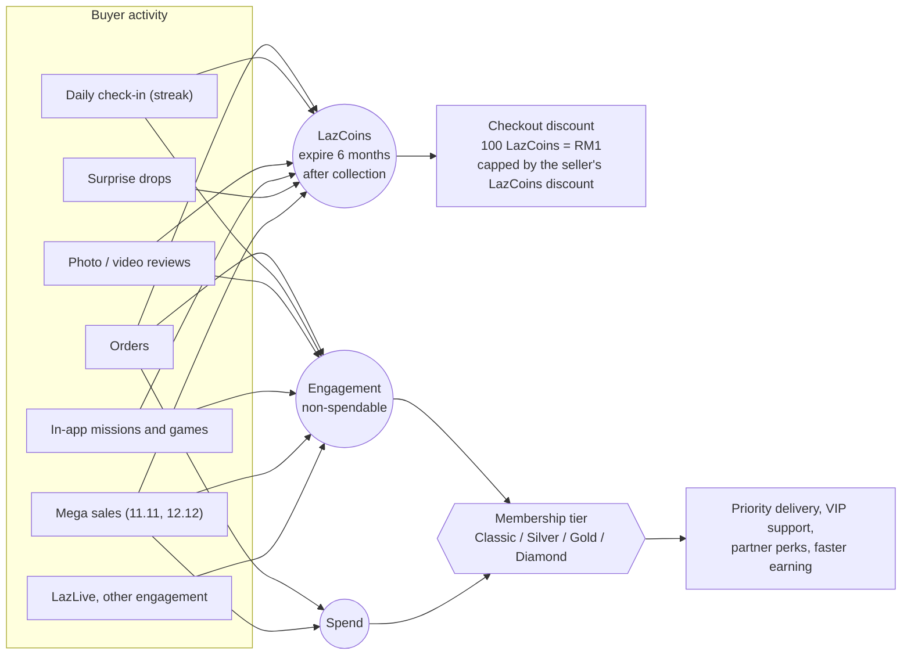
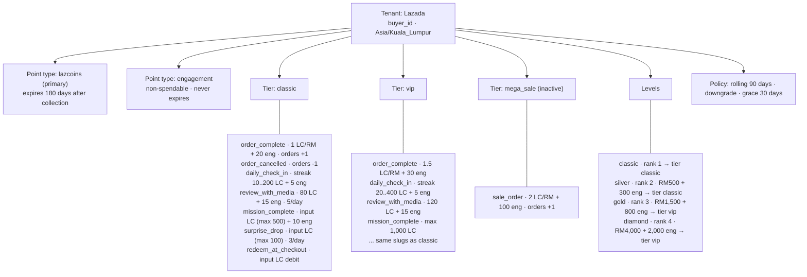
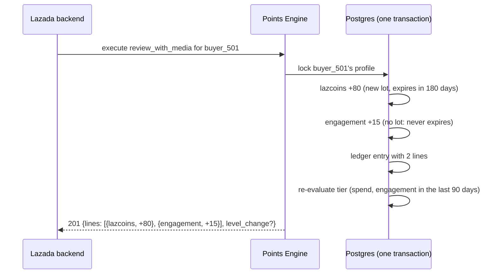
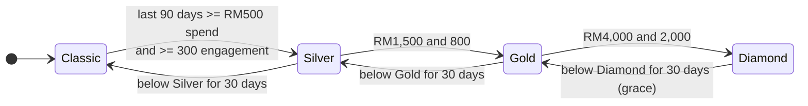
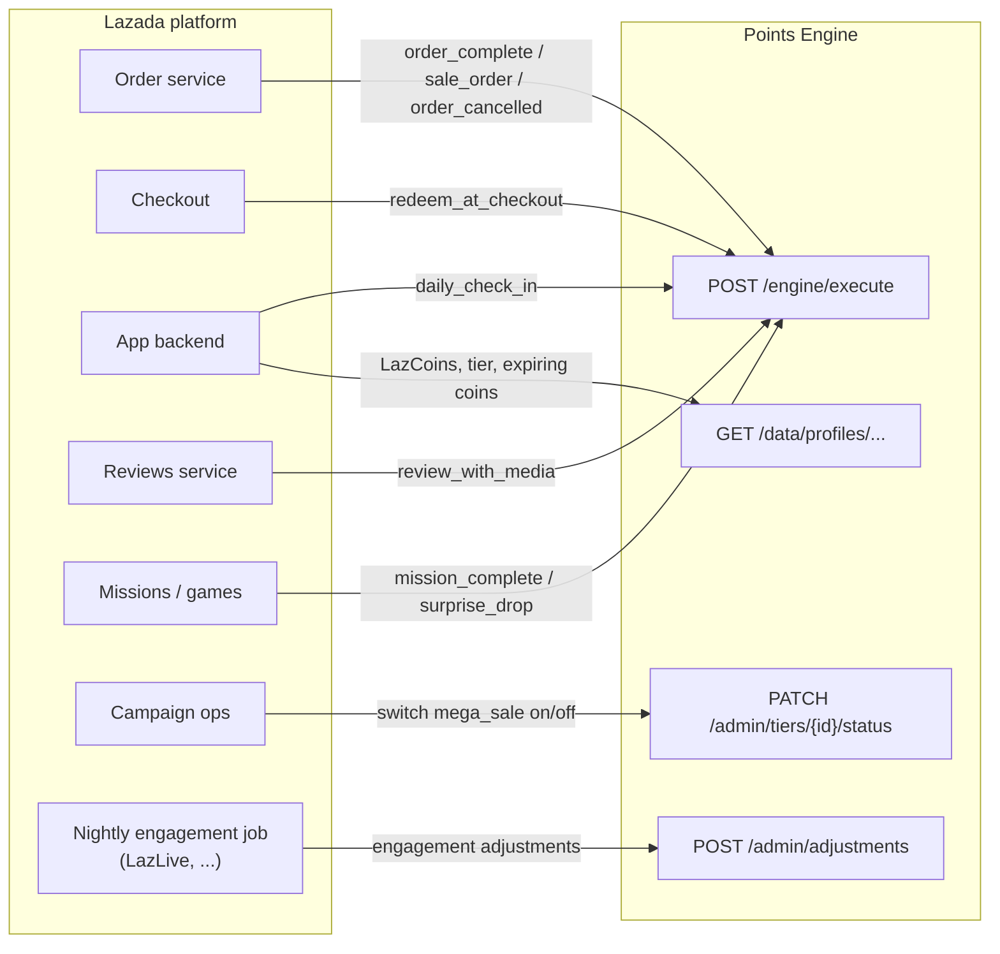
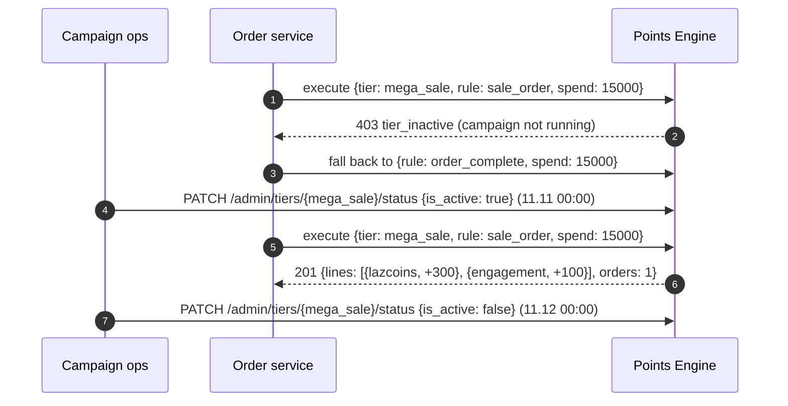

# Lazada on the Points Engine

How Lazada's loyalty program works, how it is configured as a tenant in this engine
(`seeds/lazada.json`), and how Lazada's backend talks to the engine.

> **Sources and assumptions.** This follows Malaysian coverage of LazCoins (2023), Lazada
> Philippines' help pages, and Lazada's Membership relaunch announced in December 2025. Lazada
> doesn't publish its tier thresholds or how "engagement" is scored, so those values are
> *illustrative*. Everything is configuration.

## 1. How Lazada's points system works

Lazada runs **two tracks**, and the second one needs a counter that isn't money:

1. **LazCoins**, a spendable currency. Each LazCoin expires 6 months after it is collected.
2. **Lazada Membership** (Classic, Silver, Gold, Diamond), earned from **spending, engagement on
   the platform, and taking part in major sales events**, and recalculated monthly.



| Aspect | Lazada's rule |
|---|---|
| Earning LazCoins | Purchases, daily check-ins (with streak bonuses during campaigns), reviews with photos or video (80 LazCoins in Lazada's example), missions, games, surprise drops |
| Earning limit | "No limit to the amount of LazCoins consumers can earn" |
| Value | 100 LazCoins = RM1 (Malaysia); applied automatically at checkout |
| Expiry | Each LazCoin expires 6 months after it is collected |
| Redemption caps | Set per seller (the seller's LazCoins discount limits redemption on its items) |
| Membership tiers | Classic, Silver, Gold, Diamond |
| Qualifying | Spending, platform engagement, and participation in key sales events |
| Recalculation | Monthly |

## 2. How it is configured in the engine

### 2.1 Concept mapping

| Lazada concept | Engine concept | Configuration |
|---|---|---|
| A buyer | Entity, keyed by `buyer_id` | `tenant.architecture_key` |
| Malaysia's calendar | Tenant time zone `Asia/Kuala_Lumpur` | Expiry dates and check-in days follow MYT |
| LazCoins | Primary point type `lazcoins` | Spendable, `expiry_mode: days`, `expiry_value: 180`, no limits |
| Engagement | Second point type `engagement` | **`spendable: false`**, never expires. Rules can only award it, and the balance can never go negative |
| LazCoins + engagement from the same action | **Several effects on one rule** | For example `review_with_media` = +80 `lazcoins` and +15 `engagement` in one atomic transaction |
| LazCoins on orders | Effect `per_spend` | `rate_points: 1, rate_per: 100` = 1 LazCoin per RM1 *(illustrative)*, spend in sen |
| Check-in streak | Effect `streak` | `steps: [10, 20, 30, 50, 80, 120, 200]` *(illustrative)* plus +5 engagement |
| Missions, games, surprise drops | Effect `input` (credit) | The service sends the prize as `amount` |
| Engagement from other systems (LazLive watch time, ...) | Adjustment on `engagement` | A nightly batch job, with an idempotency key per buyer and day |
| Redeem at checkout | Effect `input` (debit) | Checkout applies the seller's cap |
| Mega sales | Tier `mega_sale`, **inactive** by default | Switched on for the campaign; sale orders name the tier explicitly |
| Membership tiers | Levels with ranks 1-4, **`min_spend` + `min_points: {"engagement": N}`** | Silver RM500 + 300, Gold RM1,500 + 800, Diamond RM4,000 + 2,000 *(illustrative)* |
| Monthly recalculation | Level policy `basis: rolling`, `window_days: 90`, `downgrade: true`, `grace_days: 30` | The level sweep re-evaluates hourly; a buyer who drops below gets a 30-day grace |
| Gold/Diamond earn faster | Gold and Diamond link tier `vip` | 1.5x LazCoins on orders and bigger check-in and review rewards |

### 2.2 What gets created



### 2.3 One action, two currencies



Both balances change together or not at all.

### 2.4 How membership moves



**Engagement earned** counts rule credits and adjustments, so a buyer can't lose a tier by
spending LazCoins (engagement can't be spent at all). Spend and engagement older than 90 days
drop out of the window, and the hourly sweep applies that even to buyers who do nothing. That
plays the role of Lazada's monthly recalculation.

If Lazada's real scheme is "status for next month is decided by this month's activity", switch
the policy to `{"basis": "calendar", "period_months": 1, "downgrade": true}`: a tier reached in
one month then lasts through the next.

## 3. How Lazada's backend talks to the engine

### 3.1 Integration architecture



### 3.2 Everyday order

```sh
curl -X POST $ENGINE/engine/execute -H "Authorization: Bearer $LAZADA_KEY" -d '{
  "buyer_id": "buyer_501", "rule": "order_complete", "spend": 25000,
  "idempotency_key": "lazada-order-70001"
}'
```

```json
{
  "tier": "classic", "rule": "order_complete",
  "lines": [
    { "point_type": "engagement", "delta": 20, "balance_before": 20, "balance_after": 40 },
    { "point_type": "lazcoins", "delta": 250, "balance_before": 90, "balance_after": 340 }
  ],
  "spend": 25000, "orders": 1, "replayed": false
}
```

No `tier` is sent: Classic and Silver buyers get the `classic` rules, Gold and Diamond buyers get
`vip`.

### 3.3 Mega sale (11.11)



The `+100 engagement` per sale order is how "participation in key sales events" feeds the
membership tier.

### 3.4 Engagement from other systems

Some engagement happens outside the order flow, such as watching LazLive streams. A nightly job
adds it as an adjustment on the non-spendable `engagement` type:

```sh
curl -X POST $ENGINE/admin/adjustments -H "Authorization: Bearer $LAZADA_KEY" -d '{
  "entity_id": "buyer_501", "point_type": "engagement", "points": 250,
  "reason": "LazLive watch time, nightly import",
  "idempotency_key": "lazada-lazlive-import-buyer_501-2026-10-19"
}'
```

Adjustments count as engagement earned, so this can promote the buyer. In the demo it lifts
`buyer_501` to Silver. The idempotency key makes a re-run of the job harmless.

### 3.5 Checkout, check-in, reviews, missions

| Event | Call |
|---|---|
| Checkout burns LazCoins (after applying the seller's cap) | `{"rule": "redeem_at_checkout", "amount": 300, "idempotency_key": "lazada-checkout-99001"}` |
| Daily check-in | `{"rule": "daily_check_in", "idempotency_key": "checkin-buyer_501-2026-10-19"}` → `streak: {days: n}`; a second claim the same day gets `429 streak_already_claimed` |
| Review with media | `{"rule": "review_with_media", "idempotency_key": "lazada-review-<review id>"}` (5 a day, 60 s apart) |
| Mission prize | `{"rule": "mission_complete", "amount": 200, "idempotency_key": "mission-<id>-<buyer>"}` |
| Surprise drop | `{"rule": "surprise_drop", "amount": 50, ...}` (3 a day, max 100 each) |
| Cancellation | `{"rule": "order_cancelled", "spend": -25000, "idempotency_key": "lazada-order-70001-cancel"}` |

### 3.6 Showing the wallet and tier

```json
{
  "entity_id": "buyer_501", "balance": 540,
  "balances": {
    "engagement": { "balance": 320, "lifetime_earned": 320, "qualifying_earned": 320 },
    "lazcoins": { "balance": 540, "lifetime_earned": 840, "qualifying_earned": 840 }
  },
  "lifetime_spend": 55000, "qualifying_spend": 55000,
  "lifetime_orders": 2, "qualifying_orders": 2,
  "level_slug": "silver", "tier_slug": "classic", "below_level_since": null
}
```

- `balance` is the primary type (LazCoins), kept for backward compatibility.
- `qualifying_spend` and `balances.engagement.qualifying_earned` are the last 90 days, which is
  what the tier-progress bar needs (Gold needs RM1,500 and 800 engagement).
- `GET /data/profiles/buyer_501/expirations` lists LazCoins lots and when they expire, one per
  day of activity.
- `GET /data/profiles/buyer_501/level-history` shows every tier change with the spend and
  engagement that caused it.

### 3.7 Error handling

| Response | Meaning | Action |
|---|---|---|
| `403 tier_inactive` | A mega-sale call outside the campaign | Fall back to `order_complete` |
| `422 insufficient_balance` | Not enough LazCoins (or engagement, for a negative adjustment) | Refresh the balance |
| `422 amount_out_of_range` | Prize above the rule's maximum | Clamp in the mission service |
| `429 rate_limit_exceeded` | 6th review today, or 4th surprise drop | Don't retry today |
| `429 streak_already_claimed` | Already checked in today | `Retry-After` = seconds to midnight MYT |
| `200` + `replayed: true` | Duplicate event | Treat as success |
| `503 limiter_unavailable` | Redis down | Retry with backoff, same idempotency key |

## 4. Seeded demo data

| Buyer | What happened | Resulting state |
|---|---|---|
| `buyer_501` | Check-in, photo review, orders of RM250 and RM300, a 200-LazCoins mission, 250 engagement from LazLive (→ **Silver**: RM550 and 320 engagement), redeemed 300 LazCoins | 540 LazCoins, 320 engagement; **Silver** |
| `buyer_502` | Mega-sale order refused (campaign off), 50-LazCoins surprise drop, RM99.90 order | 149 LazCoins, 20 engagement; Classic |

## 5. Applying the configuration

```sh
go run ./cmd/seed -platform-token "$PLATFORM_ADMIN_TOKEN" \
  -keys-file seeds/tenant_keys.local.json -file seeds/lazada.json
```
