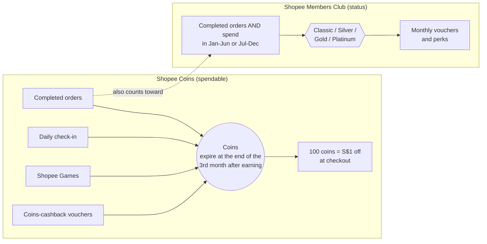
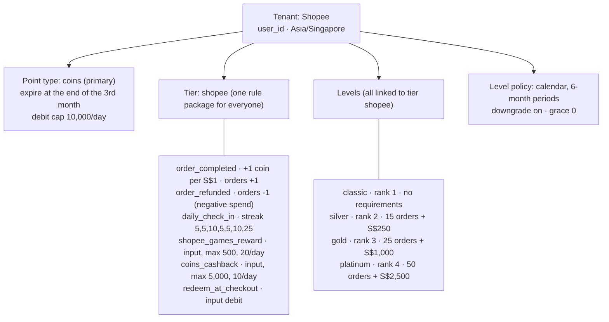
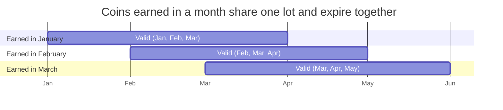
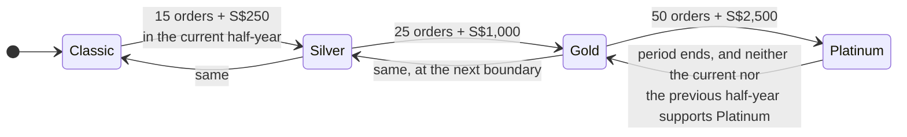
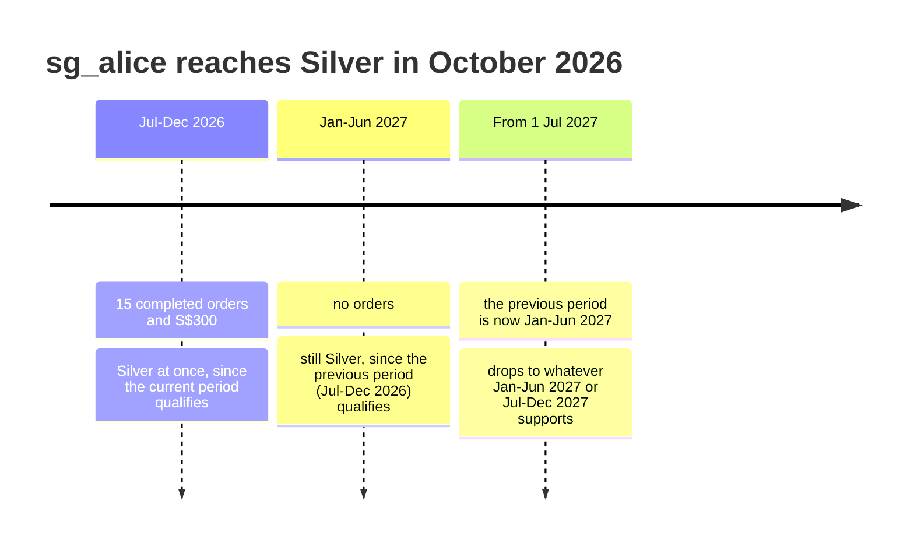
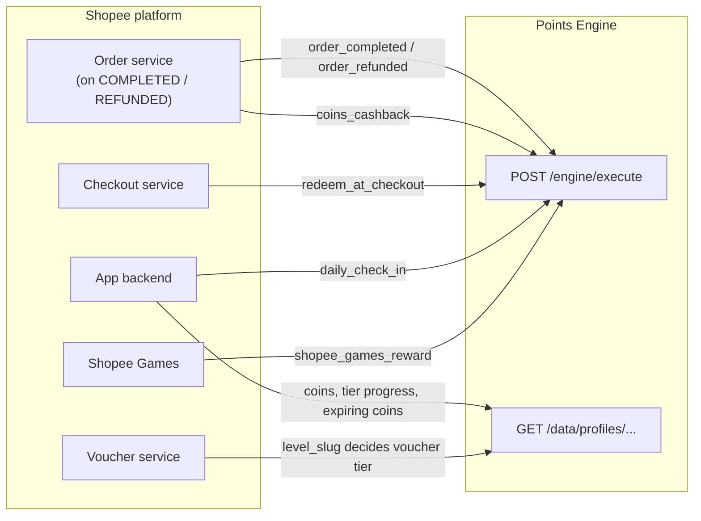
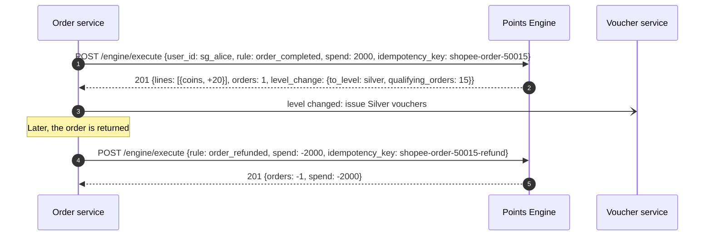
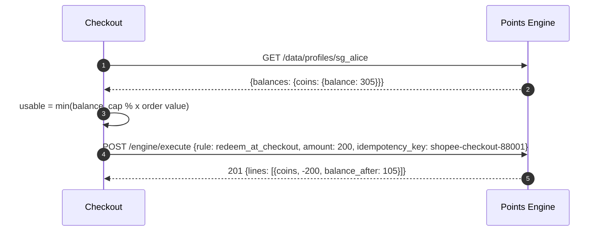

# Shopee on the Points Engine

How Shopee's loyalty program works, how it is configured as a tenant in this engine
(`seeds/shopee.json`), and how Shopee's backend talks to the engine.

> **Sources and assumptions.** This follows Shopee Singapore's help-centre pages for Shopee
> Coins and the Shopee Members Club terms, plus Malaysian and Philippine coverage for tier
> thresholds. Shopee doesn't publish every number (Platinum's Singapore threshold, coin caps,
> check-in rewards), so values marked *illustrative* are stand-ins. Everything is configuration.

## 1. How Shopee's points system works

Shopee runs **two separate tracks**:

1. **Shopee Coins**, a spendable currency that expires at the end of the third month.
2. **Shopee Members Club**, a status ladder (Classic → Silver → Gold → Platinum) earned from
   **completed orders and spend** within a fixed half-year.



| Aspect | Shopee's rule |
|---|---|
| Earning coins | Purchases, activities (check-in, games) and in-app tasks |
| Value | 100 coins = S$1 off a purchase; no minimum balance to redeem |
| Expiry | End of the third month after earning, counting the earning month as month 1 (January coins expire after 31 March) |
| Redemption caps | Vary by market and promotion (for example a share of the order value) |
| Members Club tiers | Classic, Silver, Gold, Platinum |
| Qualifying | **Both** a minimum number of completed orders **and** a minimum spend within the qualifying period. Singapore examples: Silver = 15 orders + S$250, Gold = 25 orders + S$1,000 |
| Qualifying period | Fixed half-years. Activity in 1 Jan-30 Jun qualifies you for 1 Jul-31 Dec, and vice versa. Reaching a tier mid-period applies immediately and lasts through the next period |
| Refunds | Returned, refunded or cancelled orders earn no qualifying points |
| Downgrade | If you don't requalify, you drop to the tier your activity supports when the period ends |

## 2. How it is configured in the engine

### 2.1 Concept mapping

| Shopee concept | Engine concept | Configuration |
|---|---|---|
| A user | Entity, keyed by `user_id` | `tenant.architecture_key` |
| Singapore calendar | Tenant time zone `Asia/Singapore` | Month-end expiry and half-year boundaries follow SGT |
| Shopee Coins | Primary point type `coins` | `expiry_mode: end_of_month`, `expiry_value: 3` |
| Redemption cap | Point type limit | `debit / day / 10,000` *(illustrative)*; percentage-of-order caps stay in checkout |
| Coins on orders | Rule effect `per_spend` | `rate_points: 1, rate_per: 100` = 1 coin per S$1 *(illustrative)*, spend in cents |
| Daily check-in | Rule effect `streak` | `steps: [5, 5, 10, 5, 5, 10, 25]` *(illustrative)* |
| Games and coins-cashback prizes | Rule effect `input` (credit) | Caller sends `amount` (max 500 and 5,000) |
| Redeem at checkout | Rule effect `input` (debit) | Checkout decides how many coins the order may use |
| A completed order counts toward tiers | `order_delta: 1` on `order_completed` | Order count and spend feed the levels |
| A refund doesn't count | `order_refunded`: `order_delta: -1` plus negative spend | Removes the order and its spend from the period |
| Classic / Silver / Gold / Platinum | Levels with ranks 1-4 and **`min_orders` + `min_spend`** | Silver 15 + S$250, Gold 25 + S$1,000, Platinum 50 + S$2,500 *(illustrative)* |
| Fixed half-year qualifying periods | Level policy `basis: calendar`, `period_months: 6` | Periods aligned to 1 January; a tier met in one period is kept through the next |
| Drop at the end of the period | `downgrade: true`, `grace_days: 0` | Applied by the level sweep at the boundary |
| Tier vouchers | Not points | Shopee's voucher service reads `level_slug` from the profile |

### 2.2 What gets created



Members Club tiers don't change how coins are earned, so every level links the same `shopee`
tier. The levels are pure **status**, and the backend reads them to decide which vouchers a user
gets.

### 2.3 How coins expire



All coins earned in one month (Singapore time) go into **one lot** that expires at midnight on the
1st of the fourth month. A redemption uses the oldest lot first, so January coins are spent
before February's. When a lot expires, the engine writes an `expiry` ledger entry for whatever
is left in it.

### 2.4 How Members Club tiers move



Under the `calendar` basis the engine checks **two windows**: the current half-year and the
previous one. A user keeps the better of the two tiers, which is exactly "Jan-Jun qualifies you
for Jul-Dec":



Upgrades happen in the same transaction as the qualifying order. Period-boundary downgrades are
applied by the hourly level sweep.

## 3. How Shopee's backend talks to the engine

### 3.1 Integration architecture



### 3.2 Order completion and refund

Shopee counts only **completed** orders toward tiers, so the order service calls the engine when
an order reaches *completed*, not when it is placed.



```sh
curl -X POST $ENGINE/engine/execute -H "Authorization: Bearer $SHOPEE_KEY" -d '{
  "user_id": "sg_alice", "rule": "order_completed", "spend": 2000,
  "idempotency_key": "shopee-order-50015"
}'
```

- Spend is in **cents** (S$20.00 = `2000`), and coins are `floor(spend / 100)`.
- If a seller voucher adds cashback coins, send a second call:
  `{"rule": "coins_cashback", "amount": 300, "idempotency_key": "shopee-order-60001-cashback"}`.
- A refund reverses spend and order count, so the order stops counting toward the half-year. Any
  coins earned are left alone. To claw them back, send
  `POST /admin/adjustments {"entity_id": "...", "points": -20, "reason": "refund of order 50015"}`.

### 3.3 Checkout redemption



The coins that expire soonest are burned first. `422 insufficient_balance` (for example a
concurrent redemption on another device) and `422 point_limit_exceeded` (the daily cap) come back
before anything is deducted.

### 3.4 Showing coins and tier progress in the app

```sh
curl $ENGINE/data/profiles/sg_alice -H "Authorization: Bearer $SHOPEE_KEY"
curl $ENGINE/data/profiles/sg_alice/expirations -H "Authorization: Bearer $SHOPEE_KEY"
curl $ENGINE/admin/levels -H "Authorization: Bearer $SHOPEE_KEY"   # thresholds, to draw progress bars
```

```json
{
  "entity_id": "sg_alice", "balance": 105,
  "balances": { "coins": { "balance": 105, "lifetime_earned": 305, "qualifying_earned": 305 } },
  "lifetime_spend": 30000, "qualifying_spend": 30000,
  "lifetime_orders": 15, "qualifying_orders": 15,
  "level_slug": "silver", "below_level_since": null
}
```

```json
{ "data": [ { "point_type": "coins", "amount": 105, "expires_at": "2026-12-31T16:00:00Z" } ] }
```

`qualifying_orders` and `qualifying_spend` cover the **current half-year**, so the app can show
"10 more orders and S$700 more to reach Gold". `expires_at` is midnight on 1 January in
Singapore (16:00 UTC on 31 December), so the app can show "105 coins expire after 31 Dec".

### 3.5 Error handling

| Response | Meaning | Action |
|---|---|---|
| `200` + `replayed: true` | Duplicate delivery of the same order event | Treat as success |
| `422 insufficient_balance` | Not enough coins | Refresh the balance |
| `422 point_limit_exceeded` | Daily redemption cap reached | Show the remaining allowance |
| `422 amount_required` | `redeem_at_checkout` sent without `amount` | Bug in the caller |
| `422 spend_below_zero` / `orders_below_zero` | Refund larger than what was recorded | Check the original order was sent |
| `429 streak_already_claimed` | Already checked in today | `Retry-After` = seconds to midnight SGT |
| `503 limiter_unavailable` | Redis down | Retry with backoff, same idempotency key |

## 4. Seeded demo data

| User | What happened | Resulting state |
|---|---|---|
| `sg_alice` | 15 completed orders of S$20 (Silver on the 15th), check-in, redeemed 200 coins | 105 coins; 15 orders, S$300 this half-year; **Silver** |
| `sg_bob` | S$89.99 order (+89), 300 cashback coins, 120 game coins, order refunded, then tried to burn 50,000 coins (`insufficient_balance`) | 509 coins; 0 orders and S$0 this half-year; Classic |

## 5. Applying the configuration

```sh
go run ./cmd/seed -platform-token "$PLATFORM_ADMIN_TOKEN" \
  -keys-file seeds/tenant_keys.local.json -file seeds/shopee.json
```

To try another market, change the tenant time zone, thresholds and earn rate in the seed file:
Malaysia's Silver is 10 orders + RM500, Gold 30 + RM2,000 and Platinum 50 + RM4,000, with spend
in sen.
